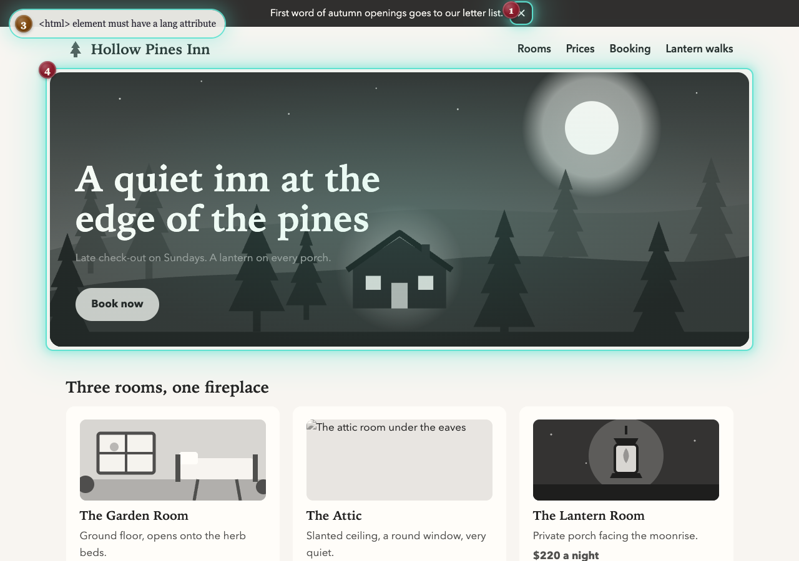
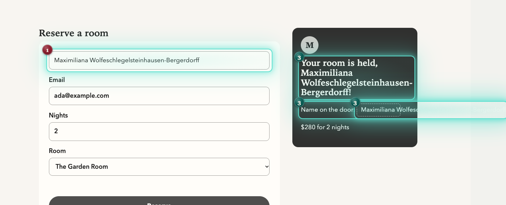

[English](README.md) | [简体中文](README.zh-CN.md) | [繁體中文](README.zh-TW.md) | [हिन्दी](README.hi.md) | [தமிழ்](README.ta.md)

# Ghost Crew

**हर वेब ऐप भुतहा है।** Ghost Crew ब्राउज़र QA के लिए एक छोटा-सा ढाँचा है। आप YAML की
कुछ पंक्तियों में अपने पेज की एक सैर लिखते हैं। एक भूत असली Chrome में वही सैर करता है,
देखता है कि क्या टूटा है, और एक *प्रेत-तस्वीर* लौटाता है: एक स्क्रीनशॉट, जिसमें हर समस्या
पर घेरा और नंबर होता है।

इस ढाँचे पर दो ऐप बने हैं:

- **Poltergeist** वह खोजता है जिसे कुछ लोग देख, छू या पढ़ नहीं पाते (axe-core, कीबोर्ड सैर, फ़ोकस रिंग, फ़ोन पर ओवरफ़्लो)।
- **Phantom Form** फ़ॉर्म में वही टाइप करता है जो असली लोग टाइप करते हैं (इमोजी वाले नाम, एपॉस्ट्रॉफ़ी, मार्कअप, नकारात्मक संख्याएँ) और जो टूटता है उसकी तस्वीर लेता है।

**लाइव साइट:** [alex4524.github.io/ghost-crew](https://alex4524.github.io/ghost-crew/), जिस पर पिछली रात के रन के प्रेत-सभा रिकॉर्ड हैं
([Poltergeist](https://alex4524.github.io/ghost-crew/reports/poltergeist/),
[Phantom Form](https://alex4524.github.io/ghost-crew/reports/phantom-form/),
[भूत भगाने के बाद](https://alex4524.github.io/ghost-crew/reports/phantom-form-exorcised/))।
डेमो सराय भी लाइव है: [भुतहा](https://alex4524.github.io/ghost-crew/demo/haunted/) और
[भूत-मुक्त](https://alex4524.github.io/ghost-crew/demo/exorcised/)।

साइट, डेमो सराय और प्रेत-सभा रिकॉर्ड English, 简体中文, 繁體中文, हिन्दी और தமிழ் में पढ़े
जा सकते हैं। डिफ़ॉल्ट भाषा अंग्रेज़ी है; भाषा मेनू हर पेज के ऊपर है। गड़बड़ियों का विवरण
सेंस लिखते हैं, और वह अंग्रेज़ी में ही रहता है।



## आज़माएँ

आपको Node 20+ और Google Chrome चाहिए। सिर्फ़ उन्हीं साइटों पर चलाएँ जो आपकी हैं या जिन्हें
जाँचने की अनुमति है।

```bash
# nothing to install
npx -y -p github:alex4524/ghost-crew poltergeist https://your.app
npx -y -p github:alex4524/ghost-crew phantom-form https://your.app/signup

# or clone it and watch both apps haunt the demo inn
git clone https://github.com/alex4524/ghost-crew && cd ghost-crew
npm install
npm run midnight          # writes four séance records into site/reports/
open site/reports/poltergeist/index.html
npm test                  # parser, report, MCP and end-to-end tests
```

## पिछली रात के रन में क्या मिला

[`demo/haunted/`](demo/haunted/) वाली डेमो सराय में जान-बूझकर 15 बग डाले गए हैं (सूची
[`demo/README.md`](demo/README.md) में है)। [`demo/exorcised/`](demo/exorcised/) वही पेज
है, जिसके सारे बग ठीक कर दिए गए हैं।

| रन | भूत | गड़बड़ियाँ | टिप्पणी |
|---|---|---|---|
| Poltergeist, भुतहा सराय | 5 | 9 (3 क्रुद्ध, 6 बेचैन) | alt टेक्स्ट, बटन का नाम, lang, कंट्रास्ट, कीबोर्ड जाल, फ़ोकस रिंग, फ़ोन पर ओवरफ़्लो, गायब तस्वीर |
| Phantom Form, भुतहा सराय | 3 | 13 (3 क्रुद्ध, 7 बेचैन, 3 शरारती) | 13 में से 4 शाप झेल पाया |
| Poltergeist, भूत-मुक्त सराय | 5 | 0 | 9 भगाई गईं |
| Phantom Form, भूत-मुक्त सराय | 3 | 0 | 13 भगाई गईं |

ये आँकड़े 2026-11-24 के `npm run midnight` से हैं; लाइव साइट सबसे नया रन दिखाती है।

## एक भूत

```yaml
ghost: The Name Eater
lore: Signs the guest book with every name a real guest might have.
haunts: /index.html
senses:
  - cursed-inputs:
      submit: Reserve
      success: Your room is held
      valid: { Email: ada@example.com, Nights: 2 }
      fields:
        Guest name: [emoji, wide, long, markup, blank, apostrophe, rtl]
```

कदम हैं `click`, `fill`, `press`, `wait` और `scroll`। लक्ष्य वही लिखें जो इंसान देखता है:
बटन का टेक्स्ट, फ़ील्ड का लेबल, और आख़िरी उपाय के तौर पर `css:<selector>`।
`ghost-crew check <file>` बिना ब्राउज़र के जाँच करता है।



## ढाँचा

```
core/                 the skeleton: 18 files
  src/ghost.js        parse + validate *.ghost.yaml (every problem at once)
  src/runner.js       one Chrome, one context per ghost, scenes, steps, events
  src/photograph.js   living page + spirit photograph + a crop around the evidence
  src/senses/         7 senses every app gets
  src/report/         report.json, exorcism diff, the séance record (HTML)
  src/i18n/           the page language switcher shared by the site, demo and reports
  src/mcp.js          MCP server: list_ghosts, check_ghost, write_ghost, summon, read_report
app-poltergeist/      app 1: 3 senses, theme, built-in crew, 5 demo ghosts
app-phantom-form/     app 2: 14 curses, 1 sense, theme, built-in crew, 3 demo ghosts
kirocrew-app/         Kiro Crew app: Ghost Captain agent, skill, MCP server, midnight cron
demo/                 the Hollow Pines Inn, haunted and exorcised
site/                 the landing page; CI adds the nightly reports
.kiro/                specs, steering, hooks, MCP settings, a CLI agent
```

ऐप सिर्फ़ `defineSense()` और `defineApp()` के ज़रिए व्यवहार जोड़ता है। नए किस्म का भूत बस
एक फ़ाइल है:

```js
import { defineSense } from 'ghost-crew';

defineSense('no-lorem-ipsum', {
  async run(ctx) {
    const hit = await ctx.page.getByText(/lorem ipsum/i).first();
    if (await hit.count()) {
      await ctx.haunt({ mood: 'mischievous', title: 'Placeholder text shipped', locator: hit });
    }
  },
});
```

`ctx.scene(label, fn)` एक अलग प्रयोग के लिए नया पेज खोलता है (इसी तरह Phantom Form हर शाप
की अपनी तस्वीर लेता है), और `ctx.tally()` वे गिनतियाँ रखता है जो रिपोर्ट में दिखती हैं
("फ़ॉर्म 13 में से 4 शाप झेल पाया")।

## Kiro से बना

यह रिपॉज़िटरी **Kiro Crew** में योजना बनाकर बनाई गई, पहले spec लिखा गया।

| Kiro का हिस्सा | इस रिपॉज़िटरी में |
|---|---|
| Specs | [`.kiro/specs/`](.kiro/specs/): EARS रूप में कोर की आवश्यकताएँ, डेटा मॉडल के साथ डिज़ाइन, कार्य-सूची; दोनों ऐप और Kiro Crew ऐप की आवश्यकताएँ |
| Steering | [`.kiro/steering/`](.kiro/steering/): प्रोडक्ट शब्दावली, तकनीकी नियम, फ़ोल्डर और import नियम, भूत फ़ाइल का सटीक ढाँचा (सिर्फ़ `*.ghost.yaml` के लिए लोड होता है), डिज़ाइन टोकन (सिर्फ़ साइट और रिपोर्ट के लिए लोड होते हैं) |
| Hooks | [`.kiro/hooks/`](.kiro/hooks/): सहेजते ही भूत की जाँच, हर सत्र की शुरुआत में सबसे नई रिपोर्ट, सेंस सूचियों को मिलाकर रखना, एजेंट रुकने से पहले टेस्ट चलाना |
| MCP | [`.kiro/settings/mcp.json`](.kiro/settings/mcp.json): दल को एजेंट के पाँच टूल के रूप में |
| कस्टम एजेंट | [`.kiro/agents/ghost-captain.json`](.kiro/agents/ghost-captain.json), Kiro CLI के लिए |
| Kiro Crew ऐप | [`kirocrew-app/`](kirocrew-app/): Ghost Captain, एक skill, `npx` से चलने वाला MCP सर्वर, और आधी-रात गश्त का cron |

पूरा विवरण [`docs/kiro.md`](docs/kiro.md) में है।

## लाइसेंस

MIT। axe-core MPL-2.0 है, Playwright Apache-2.0 है। सराय काल्पनिक है।
