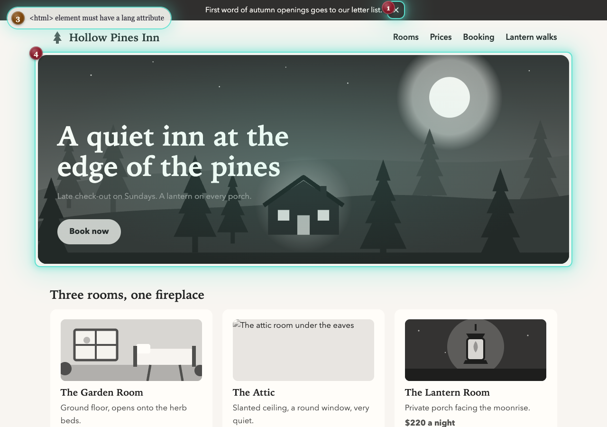
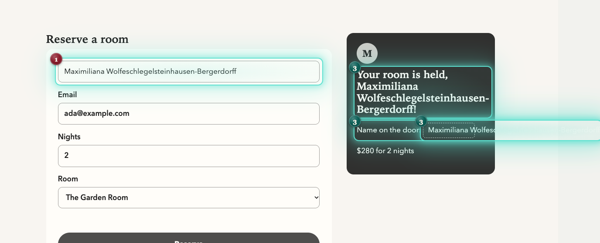

# Ghost Crew

**Every web app is haunted.** Ghost Crew is a small skeleton for browser QA. You describe
a walk through your page in a few lines of YAML. A ghost takes that walk in a real
Chrome, notices what breaks, and brings back a *spirit photograph*: a screenshot with
every problem circled and numbered.

Two apps are built on the skeleton:

- **Poltergeist** finds what some people cannot see, reach or read (axe-core, a keyboard walk, focus rings, phone overflow).
- **Phantom Form** types what real people type into forms (emoji names, apostrophes, markup, negative numbers) and photographs what breaks.

**Live site:** [alex4524.github.io/ghost-crew](https://alex4524.github.io/ghost-crew/), with séance records from last night's run
([Poltergeist](https://alex4524.github.io/ghost-crew/reports/poltergeist/),
[Phantom Form](https://alex4524.github.io/ghost-crew/reports/phantom-form/),
[after the exorcism](https://alex4524.github.io/ghost-crew/reports/phantom-form-exorcised/)).



## Try it

You need Node 20+ and Google Chrome. Only haunt sites you own or may test.

```bash
# nothing to install
npx -y -p github:alex4524/ghost-crew poltergeist https://your.app
npx -y -p github:alex4524/ghost-crew phantom-form https://your.app/signup

# or clone it and watch both apps haunt the demo inn
git clone https://github.com/alex4524/ghost-crew && cd ghost-crew
npm install
npm run midnight          # writes four séance records into site/reports/
open site/reports/poltergeist/index.html
npm test                  # parser, report, MCP and end-to-end tests
```

## What last night's run finds

The demo inn at [`demo/haunted/`](demo/haunted/) has 15 bugs planted on purpose (listed
in [`demo/README.md`](demo/README.md)). [`demo/exorcised/`](demo/exorcised/) is the same
page with all of them fixed.

| Run | Ghosts | Hauntings | Notes |
|---|---|---|---|
| Poltergeist, haunted inn | 5 | 9 (3 wrathful, 6 restless) | alt text, button name, lang, contrast, keyboard trap, focus rings, phone overflow, missing image |
| Phantom Form, haunted inn | 3 | 13 (3 wrathful, 7 restless, 3 mischievous) | survived 4 of 13 curses |
| Poltergeist, exorcised inn | 5 | 0 | 9 exorcised |
| Phantom Form, exorcised inn | 3 | 0 | 13 exorcised |

Numbers are from `npm run midnight` on 2026-11-24; the live site shows the newest run.

## A ghost

```yaml
ghost: The Name Eater
lore: Signs the guest book with every name a real guest might have.
haunts: /index.html
senses:
  - cursed-inputs:
      submit: Reserve
      success: Your room is held
      valid: { Email: ada@example.com, Nights: 2 }
      fields:
        Guest name: [emoji, wide, long, markup, blank, apostrophe, rtl]
```

Steps are `click`, `fill`, `press`, `wait` and `scroll`. Targets are what a person
sees: a button's text, a field's label, or `css:<selector>` as a last resort.
`ghost-crew check <file>` validates without a browser.



## The skeleton

```
core/                 the skeleton: 16 files
  src/ghost.js        parse + validate *.ghost.yaml (every problem at once)
  src/runner.js       one Chrome, one context per ghost, scenes, steps, events
  src/photograph.js   living page + spirit photograph + a crop around the evidence
  src/senses/         7 senses every app gets
  src/report/         report.json, exorcism diff, the séance record (HTML)
  src/mcp.js          MCP server: list_ghosts, check_ghost, write_ghost, summon, read_report
app-poltergeist/      app 1: 3 senses, theme, built-in crew, 5 demo ghosts
app-phantom-form/     app 2: 14 curses, 1 sense, theme, built-in crew, 3 demo ghosts
kirocrew-app/         Kiro Crew app: Ghost Captain agent, skill, MCP server, midnight cron
demo/                 the Hollow Pines Inn, haunted and exorcised
site/                 the landing page; CI adds the nightly reports
.kiro/                specs, steering, hooks, MCP settings, a CLI agent
```

An app adds behaviour only through `defineSense()` and `defineApp()`. A new kind of
ghost is one file:

```js
import { defineSense } from 'ghost-crew';

defineSense('no-lorem-ipsum', {
  async run(ctx) {
    const hit = await ctx.page.getByText(/lorem ipsum/i).first();
    if (await hit.count()) {
      await ctx.haunt({ mood: 'mischievous', title: 'Placeholder text shipped', locator: hit });
    }
  },
});
```

`ctx.scene(label, fn)` opens a fresh page for a separate experiment (that is how Phantom
Form gives every curse its own photograph), and `ctx.tally()` keeps counts the report
shows ("The form survived 4 of 13 curses").

## Built with Kiro

This repository was planned and built in **Kiro Crew**, spec first.

| Kiro part | In this repo |
|---|---|
| Specs | [`.kiro/specs/`](.kiro/specs/): core requirements in EARS form, design with the data model, the task list; requirements for both apps and the Kiro Crew app |
| Steering | [`.kiro/steering/`](.kiro/steering/): product vocabulary, tech rules, folder and import rules, the exact ghost file shape (loaded only for `*.ghost.yaml`), design tokens (loaded only for the site and report) |
| Hooks | [`.kiro/hooks/`](.kiro/hooks/): validate a ghost on save, brief each session with the newest report, keep sense lists in sync, run tests before the agent stops |
| MCP | [`.kiro/settings/mcp.json`](.kiro/settings/mcp.json): the crew as five agent tools |
| Custom agent | [`.kiro/agents/ghost-captain.json`](.kiro/agents/ghost-captain.json) for Kiro CLI |
| Kiro Crew app | [`kirocrew-app/`](kirocrew-app/): Ghost Captain, a skill, the MCP server via `npx`, and a midnight patrol cron |

The full write-up is in [`docs/kiro.md`](docs/kiro.md).

## License

MIT. axe-core is MPL-2.0, Playwright is Apache-2.0. The inn is fictional.
