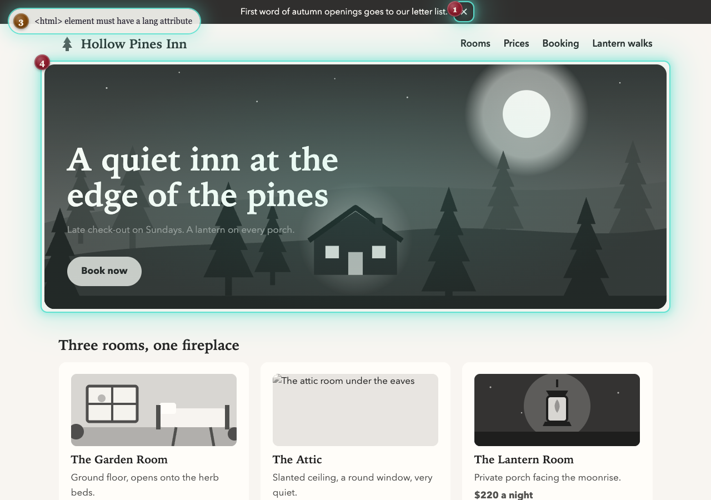
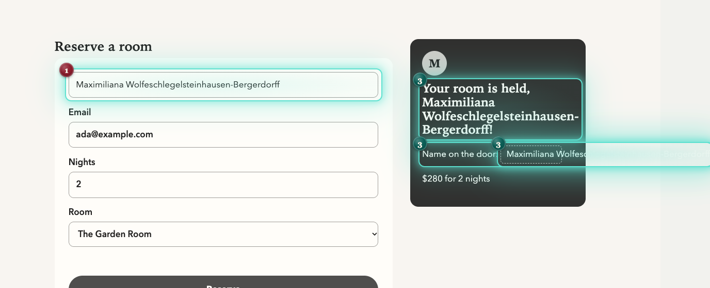

[English](README.md) | [简体中文](README.zh-CN.md) | [繁體中文](README.zh-TW.md) | [हिन्दी](README.hi.md) | [தமிழ்](README.ta.md)

# Ghost Crew

**ஒவ்வொரு வலை ஆப்பிலும் பேய் இருக்கிறது.** Ghost Crew என்பது உலாவி QA-க்கான ஒரு சிறிய
எலும்புக்கூடு. உங்கள் பக்கத்தில் ஒரு நடையை சில YAML வரிகளில் எழுதுகிறீர்கள். ஒரு பேய்
உண்மையான Chrome-இல் அந்த நடையை நடக்கிறது, எது உடைகிறது என்பதைக் கவனிக்கிறது, ஓர்
*ஆவிப் புகைப்படத்தைக்* கொண்டு வருகிறது: ஒவ்வொரு பிரச்சினையும் வட்டமிட்டு எண்ணிடப்பட்ட
ஒரு திரைப்பிடிப்பு.

இந்த எலும்புக்கூட்டின் மேல் இரண்டு ஆப்கள் உருவாக்கப்பட்டுள்ளன:

- **Poltergeist** சிலரால் பார்க்க, அடைய அல்லது படிக்க முடியாதவற்றைக் கண்டறிகிறது (axe-core, விசைப்பலகை நடை, focus வளையங்கள், தொலைபேசியில் வழிதல்).
- **Phantom Form** உண்மையான மக்கள் தட்டச்சு செய்வதைப் படிவங்களில் இடுகிறது (emoji பெயர்கள், அபோஸ்ட்ரோஃபிகள், markup, எதிர்மறை எண்கள்), உடைவதைப் புகைப்படம் எடுக்கிறது.

**நேரலைத் தளம்:** [alex4524.github.io/ghost-crew](https://alex4524.github.io/ghost-crew/), நேற்றிரவு ஓட்டத்தின் ஆவி அழைப்புப் பதிவுகளுடன்
([Poltergeist](https://alex4524.github.io/ghost-crew/reports/poltergeist/),
[Phantom Form](https://alex4524.github.io/ghost-crew/reports/phantom-form/),
[பேய் விரட்டிய பின்](https://alex4524.github.io/ghost-crew/reports/phantom-form-exorcised/)).
செயல்விளக்க விடுதியும் நேரலையில் உள்ளது: [பேய் விடுதி](https://alex4524.github.io/ghost-crew/demo/haunted/),
[பேய் விரட்டப்பட்ட விடுதி](https://alex4524.github.io/ghost-crew/demo/exorcised/).

தளம், செயல்விளக்க விடுதி, ஆவி அழைப்புப் பதிவுகள் ஆகியவற்றை English, 简体中文, 繁體中文,
हिन्दी, தமிழ் ஆகிய மொழிகளில் படிக்கலாம். இயல்பு மொழி ஆங்கிலம்; மொழி மெனு ஒவ்வொரு
பக்கத்தின் மேலே உள்ளது. கண்டுபிடிப்புகளை உணர்வுகள் எழுதுகின்றன; அவை ஆங்கிலத்திலேயே இருக்கும்.



## முயன்று பாருங்கள்

Node 20+, Google Chrome தேவை. உங்களுடைய அல்லது சோதிக்க அனுமதி உள்ள தளங்களை மட்டுமே
சோதியுங்கள்.

```bash
# nothing to install
npx -y -p github:alex4524/ghost-crew poltergeist https://your.app
npx -y -p github:alex4524/ghost-crew phantom-form https://your.app/signup

# or clone it and watch both apps haunt the demo inn
git clone https://github.com/alex4524/ghost-crew && cd ghost-crew
npm install
npm run midnight          # writes four séance records into site/reports/
open site/reports/poltergeist/index.html
npm test                  # parser, report, MCP and end-to-end tests
```

## நேற்றிரவு ஓட்டம் என்ன கண்டது

[`demo/haunted/`](demo/haunted/) செயல்விளக்க விடுதியில் வேண்டுமென்றே 15 பிழைகள்
வைக்கப்பட்டுள்ளன (பட்டியல் [`demo/README.md`](demo/README.md)-இல்).
[`demo/exorcised/`](demo/exorcised/) அதே பக்கம்; எல்லாப் பிழைகளும் சரிசெய்யப்பட்டுள்ளன.

| ஓட்டம் | பேய்கள் | பேய் நிகழ்வுகள் | குறிப்பு |
|---|---|---|---|
| Poltergeist, பேய் விடுதி | 5 | 9 (3 சினமுள்ள, 6 அமைதியற்ற) | alt உரை, பொத்தான் பெயர், lang, வேறுபாடு, விசைப்பலகைப் பொறி, focus வளையங்கள், தொலைபேசியில் வழிதல், காணாமல் போன படம் |
| Phantom Form, பேய் விடுதி | 3 | 13 (3 சினமுள்ள, 7 அமைதியற்ற, 3 குறும்பான) | 13 சாபங்களில் 4 சாபங்களைத் தாங்கியது |
| Poltergeist, பேய் விரட்டப்பட்ட விடுதி | 5 | 0 | 9 விரட்டப்பட்டன |
| Phantom Form, பேய் விரட்டப்பட்ட விடுதி | 3 | 0 | 13 விரட்டப்பட்டன |

எண்கள் 2026-11-24 அன்று ஓடிய `npm run midnight`-இலிருந்து; நேரலைத் தளம் புதிய ஓட்டத்தைக் காட்டுகிறது.

## ஒரு பேய்

```yaml
ghost: The Name Eater
lore: Signs the guest book with every name a real guest might have.
haunts: /index.html
senses:
  - cursed-inputs:
      submit: Reserve
      success: Your room is held
      valid: { Email: ada@example.com, Nights: 2 }
      fields:
        Guest name: [emoji, wide, long, markup, blank, apostrophe, rtl]
```

படிகள்: `click`, `fill`, `press`, `wait`, `scroll`. இலக்குகள் ஒருவர் பார்ப்பவை: பொத்தானின்
உரை, புலத்தின் லேபிள், கடைசி வழியாக `css:<selector>`. `ghost-crew check <file>` உலாவி
இல்லாமலே சரிபார்க்கிறது.



## எலும்புக்கூடு

```
core/                 the skeleton: 18 files
  src/ghost.js        parse + validate *.ghost.yaml (every problem at once)
  src/runner.js       one Chrome, one context per ghost, scenes, steps, events
  src/photograph.js   living page + spirit photograph + a crop around the evidence
  src/senses/         7 senses every app gets
  src/report/         report.json, exorcism diff, the séance record (HTML)
  src/i18n/           the page language switcher shared by the site, demo and reports
  src/mcp.js          MCP server: list_ghosts, check_ghost, write_ghost, summon, read_report
app-poltergeist/      app 1: 3 senses, theme, built-in crew, 5 demo ghosts
app-phantom-form/     app 2: 14 curses, 1 sense, theme, built-in crew, 3 demo ghosts
kirocrew-app/         Kiro Crew app: Ghost Captain agent, skill, MCP server, midnight cron
demo/                 the Hollow Pines Inn, haunted and exorcised
site/                 the landing page; CI adds the nightly reports
.kiro/                specs, steering, hooks, MCP settings, a CLI agent
```

ஒரு ஆப் `defineSense()`, `defineApp()` வழியாக மட்டுமே நடத்தையைச் சேர்க்கிறது. புதிய வகைப்
பேய் என்பது ஒரே ஒரு கோப்பு:

```js
import { defineSense } from 'ghost-crew';

defineSense('no-lorem-ipsum', {
  async run(ctx) {
    const hit = await ctx.page.getByText(/lorem ipsum/i).first();
    if (await hit.count()) {
      await ctx.haunt({ mood: 'mischievous', title: 'Placeholder text shipped', locator: hit });
    }
  },
});
```

`ctx.scene(label, fn)` ஒரு தனிச் சோதனைக்குப் புதிய பக்கத்தைத் திறக்கிறது (இப்படித்தான்
Phantom Form ஒவ்வொரு சாபத்துக்கும் தனிப் புகைப்படம் எடுக்கிறது), `ctx.tally()` அறிக்கையில்
காட்டப்படும் எண்ணிக்கைகளை வைத்திருக்கிறது ("படிவம் 13 சாபங்களில் 4 சாபங்களைத் தாங்கியது").

## Kiro-வால் உருவானது

இந்தக் களஞ்சியம் **Kiro Crew**-இல் திட்டமிடப்பட்டு உருவாக்கப்பட்டது; முதலில் spec.

| Kiro பகுதி | இந்தக் களஞ்சியத்தில் |
|---|---|
| Specs | [`.kiro/specs/`](.kiro/specs/): EARS வடிவில் மையத் தேவைகள், தரவு மாதிரியுடன் வடிவமைப்பு, பணிப் பட்டியல்; இரண்டு ஆப்கள், Kiro Crew ஆப் ஆகியவற்றின் தேவைகள் |
| Steering | [`.kiro/steering/`](.kiro/steering/): தயாரிப்புச் சொற்களஞ்சியம், தொழில்நுட்ப விதிகள், கோப்புறை மற்றும் import விதிகள், பேய் கோப்பின் சரியான வடிவம் (`*.ghost.yaml`-க்கு மட்டும் ஏற்றப்படும்), வடிவமைப்பு token-கள் (தளம், அறிக்கைக்கு மட்டும் ஏற்றப்படும்) |
| Hooks | [`.kiro/hooks/`](.kiro/hooks/): சேமித்ததும் பேயைச் சரிபார்த்தல், ஒவ்வொரு அமர்வின் தொடக்கத்தில் புதிய அறிக்கை, உணர்வுப் பட்டியல்களை ஒத்திசைத்தல், முகவர் நிற்கும் முன் சோதனைகள் |
| MCP | [`.kiro/settings/mcp.json`](.kiro/settings/mcp.json): குழுவை ஐந்து முகவர் கருவிகளாக |
| தனிப்பயன் முகவர் | [`.kiro/agents/ghost-captain.json`](.kiro/agents/ghost-captain.json), Kiro CLI-க்கு |
| Kiro Crew ஆப் | [`kirocrew-app/`](kirocrew-app/): Ghost Captain, ஒரு skill, `npx` மூலம் இயங்கும் MCP சேவையகம், நள்ளிரவு ரோந்து cron |

முழு விளக்கம் [`docs/kiro.md`](docs/kiro.md)-இல் உள்ளது.

## உரிமம்

MIT. axe-core MPL-2.0, Playwright Apache-2.0. விடுதி கற்பனையானது.
