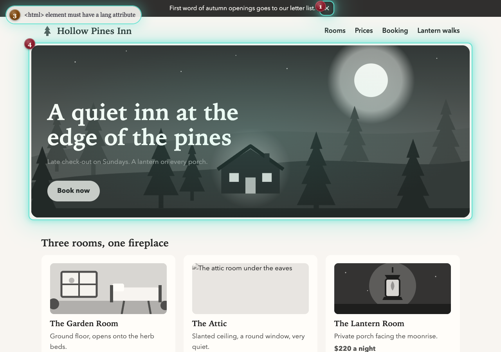
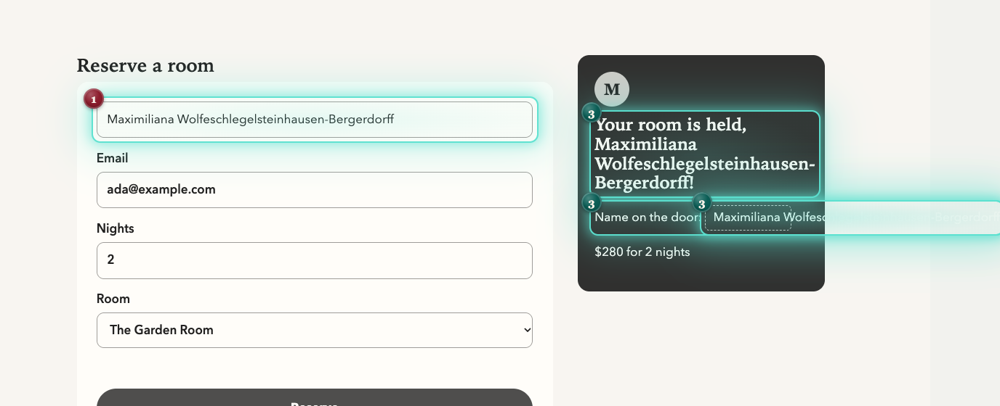

[English](README.md) | [简体中文](README.zh-CN.md) | [繁體中文](README.zh-TW.md) | [हिन्दी](README.hi.md) | [தமிழ்](README.ta.md)

# Ghost Crew

**每个网页应用都在闹鬼。** Ghost Crew 是一个小巧的浏览器验收骨架。你用几行 YAML
描述一次页面巡查。一个幽灵会在真实的 Chrome 里走一遍，发现哪里坏了，再带回一张
*灵异照片*：一张截图，每个问题都被圈出并编号。

骨架上做了两个应用：

- **Poltergeist** 找出有人看不见、够不着或读不懂的地方（axe-core、键盘巡查、焦点框、手机溢出）。
- **Phantom Form** 把真人会输入的内容填进表单（表情名字、撇号、HTML 标记、负数），把出问题的地方拍下来。

**线上站点：**[alex4524.github.io/ghost-crew](https://alex4524.github.io/ghost-crew/)，上面有昨晚运行的降神记录
（[Poltergeist](https://alex4524.github.io/ghost-crew/reports/poltergeist/)、
[Phantom Form](https://alex4524.github.io/ghost-crew/reports/phantom-form/)、
[驱鬼之后](https://alex4524.github.io/ghost-crew/reports/phantom-form-exorcised/)）。
演示旅馆也在线上：[闹鬼版](https://alex4524.github.io/ghost-crew/demo/haunted/)和
[驱鬼后](https://alex4524.github.io/ghost-crew/demo/exorcised/)。

站点、演示旅馆和降神记录都可以用 English、简体中文、繁體中文、हिन्दी 和 தமிழ் 阅读。
默认是英文，语言菜单在每个页面顶部。具体的发现由感官写出，保留英文。



## 试一试

需要 Node 20+ 和 Google Chrome。只巡查你自己的、或有权测试的网站。

```bash
# nothing to install
npx -y -p github:alex4524/ghost-crew poltergeist https://your.app
npx -y -p github:alex4524/ghost-crew phantom-form https://your.app/signup

# or clone it and watch both apps haunt the demo inn
git clone https://github.com/alex4524/ghost-crew && cd ghost-crew
npm install
npm run midnight          # writes four séance records into site/reports/
open site/reports/poltergeist/index.html
npm test                  # parser, report, MCP and end-to-end tests
```

## 昨晚的运行发现了什么

[`demo/haunted/`](demo/haunted/) 这家演示旅馆故意埋了 15 个 bug（清单见
[`demo/README.md`](demo/README.md)）。[`demo/exorcised/`](demo/exorcised/) 是同一个页面，
所有 bug 都已修好。

| 运行 | 幽灵 | 闹鬼 | 说明 |
|---|---|---|---|
| Poltergeist，闹鬼版旅馆 | 5 | 9（3 暴怒，6 躁动） | 替代文字、按钮名称、lang、对比度、键盘陷阱、焦点框、手机溢出、图片缺失 |
| Phantom Form，闹鬼版旅馆 | 3 | 13（3 暴怒，7 躁动，3 调皮） | 扛住了 13 个诅咒中的 4 个 |
| Poltergeist，驱鬼后旅馆 | 5 | 0 | 已驱除 9 处 |
| Phantom Form，驱鬼后旅馆 | 3 | 0 | 已驱除 13 处 |

数字来自 2026-11-24 的 `npm run midnight`；线上站点显示最新一次运行。

## 一个幽灵

```yaml
ghost: The Name Eater
lore: Signs the guest book with every name a real guest might have.
haunts: /index.html
senses:
  - cursed-inputs:
      submit: Reserve
      success: Your room is held
      valid: { Email: ada@example.com, Nights: 2 }
      fields:
        Guest name: [emoji, wide, long, markup, blank, apostrophe, rtl]
```

步骤有 `click`、`fill`、`press`、`wait` 和 `scroll`。目标写人看得到的东西：按钮上的字、
输入框的标签，实在不行再用 `css:<selector>`。`ghost-crew check <file>` 不开浏览器就能校验。



## 骨架

```
core/                 the skeleton: 18 files
  src/ghost.js        parse + validate *.ghost.yaml (every problem at once)
  src/runner.js       one Chrome, one context per ghost, scenes, steps, events
  src/photograph.js   living page + spirit photograph + a crop around the evidence
  src/senses/         7 senses every app gets
  src/report/         report.json, exorcism diff, the séance record (HTML)
  src/i18n/           the page language switcher shared by the site, demo and reports
  src/mcp.js          MCP server: list_ghosts, check_ghost, write_ghost, summon, read_report
app-poltergeist/      app 1: 3 senses, theme, built-in crew, 5 demo ghosts
app-phantom-form/     app 2: 14 curses, 1 sense, theme, built-in crew, 3 demo ghosts
kirocrew-app/         Kiro Crew app: Ghost Captain agent, skill, MCP server, midnight cron
demo/                 the Hollow Pines Inn, haunted and exorcised
site/                 the landing page; CI adds the nightly reports
.kiro/                specs, steering, hooks, MCP settings, a CLI agent
```

应用只能通过 `defineSense()` 和 `defineApp()` 添加行为。新增一种幽灵只要一个文件：

```js
import { defineSense } from 'ghost-crew';

defineSense('no-lorem-ipsum', {
  async run(ctx) {
    const hit = await ctx.page.getByText(/lorem ipsum/i).first();
    if (await hit.count()) {
      await ctx.haunt({ mood: 'mischievous', title: 'Placeholder text shipped', locator: hit });
    }
  },
});
```

`ctx.scene(label, fn)` 会打开一个全新页面做单独的实验（Phantom Form 就是这样给每个诅咒
单独拍照的），`ctx.tally()` 记下报告里显示的计数（"表单扛住了 13 个诅咒中的 4 个"）。

## 用 Kiro 打造

这个仓库在 **Kiro Crew** 里规划和构建，先写 spec 再写代码。

| Kiro 部分 | 在本仓库 |
|---|---|
| Specs | [`.kiro/specs/`](.kiro/specs/)：EARS 格式的核心需求、带数据模型的设计、任务清单；两个应用和 Kiro Crew 应用的需求 |
| Steering | [`.kiro/steering/`](.kiro/steering/)：产品用词、技术规则、目录和引用规则、幽灵文件的准确格式（只在打开 `*.ghost.yaml` 时加载）、设计变量（只在站点和报告里加载） |
| Hooks | [`.kiro/hooks/`](.kiro/hooks/)：保存时校验幽灵，每次会话开始时报告最新记录，保持感官列表同步，代理停下前先跑测试 |
| MCP | [`.kiro/settings/mcp.json`](.kiro/settings/mcp.json)：把幽灵队变成五个代理工具 |
| 自定义代理 | [`.kiro/agents/ghost-captain.json`](.kiro/agents/ghost-captain.json)，给 Kiro CLI 用 |
| Kiro Crew 应用 | [`kirocrew-app/`](kirocrew-app/)：Ghost Captain、一个技能、通过 `npx` 启动的 MCP 服务，以及午夜巡逻定时任务 |

完整说明见 [`docs/kiro.md`](docs/kiro.md)。

## 许可证

MIT。axe-core 是 MPL-2.0，Playwright 是 Apache-2.0。旅馆是虚构的。
