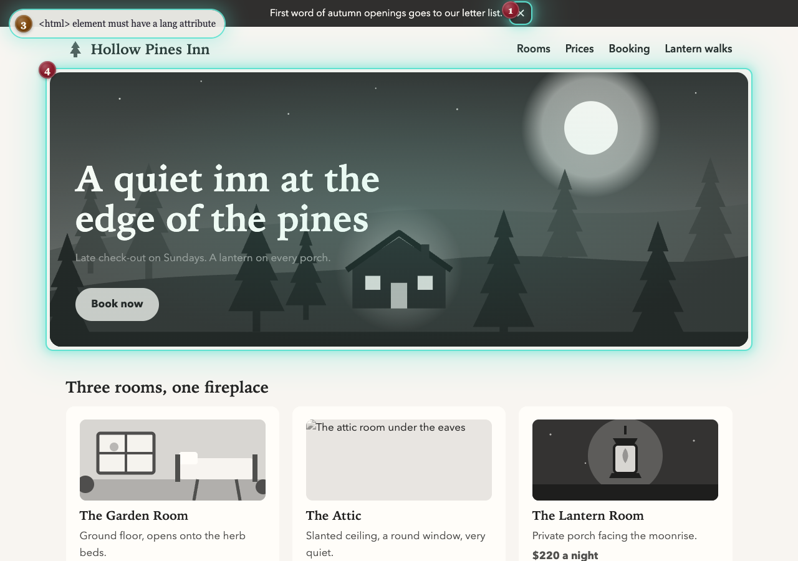
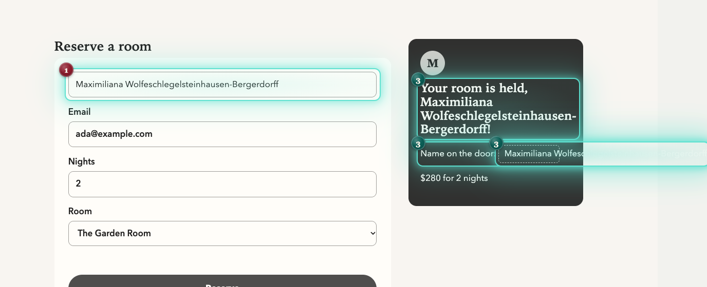

[English](README.md) | [简体中文](README.zh-CN.md) | [繁體中文](README.zh-TW.md) | [हिन्दी](README.hi.md) | [தமிழ்](README.ta.md)

# Ghost Crew

**每個網頁應用都在鬧鬼。** Ghost Crew 是一個小巧的瀏覽器驗收骨架。你用幾行 YAML
描述一次頁面巡查。一個幽靈會在真實的 Chrome 裡走一遍，發現哪裡壞了，再帶回一張
*靈異照片*：一張截圖，每個問題都被圈出並編號。

骨架上做了兩個應用：

- **Poltergeist** 找出有人看不見、碰不到或讀不懂的地方（axe-core、鍵盤巡查、焦點框、手機溢出）。
- **Phantom Form** 把真人會輸入的內容填進表單（表情名字、撇號、HTML 標記、負數），把出問題的地方拍下來。

**線上網站：**[alex4524.github.io/ghost-crew](https://alex4524.github.io/ghost-crew/)，上面有昨晚執行的降神紀錄
（[Poltergeist](https://alex4524.github.io/ghost-crew/reports/poltergeist/)、
[Phantom Form](https://alex4524.github.io/ghost-crew/reports/phantom-form/)、
[驅鬼之後](https://alex4524.github.io/ghost-crew/reports/phantom-form-exorcised/)）。
示範旅館也在線上：[鬧鬼版](https://alex4524.github.io/ghost-crew/demo/haunted/)和
[驅鬼後](https://alex4524.github.io/ghost-crew/demo/exorcised/)。

網站、示範旅館和降神紀錄都可以用 English、简体中文、繁體中文、हिन्दी 和 தமிழ் 閱讀。
預設是英文，語言選單在每個頁面頂部。具體的發現由感官寫出，保留英文。



## 試一試

需要 Node 20+ 和 Google Chrome。只巡查你自己的、或有權測試的網站。

```bash
# nothing to install
npx -y -p github:alex4524/ghost-crew poltergeist https://your.app
npx -y -p github:alex4524/ghost-crew phantom-form https://your.app/signup

# or clone it and watch both apps haunt the demo inn
git clone https://github.com/alex4524/ghost-crew && cd ghost-crew
npm install
npm run midnight          # writes four séance records into site/reports/
open site/reports/poltergeist/index.html
npm test                  # parser, report, MCP and end-to-end tests
```

## 昨晚的執行發現了什麼

[`demo/haunted/`](demo/haunted/) 這家示範旅館故意埋了 15 個 bug（清單見
[`demo/README.md`](demo/README.md)）。[`demo/exorcised/`](demo/exorcised/) 是同一個頁面，
所有 bug 都已修好。

| 執行 | 幽靈 | 鬧鬼 | 說明 |
|---|---|---|---|
| Poltergeist，鬧鬼版旅館 | 5 | 9（3 暴怒，6 躁動） | 替代文字、按鈕名稱、lang、對比度、鍵盤陷阱、焦點框、手機溢出、圖片缺失 |
| Phantom Form，鬧鬼版旅館 | 3 | 12（3 暴怒，6 躁動，3 調皮） | 扛住了 13 個詛咒中的 4 個；在 macOS 上是 13 處，超長名字還會讓頁面橫向捲動 |
| Poltergeist，驅鬼後旅館 | 5 | 0 | 已驅除 9 處 |
| Phantom Form，驅鬼後旅館 | 3 | 0 | 已驅除 12 處 |

數字來自 2026-11-24 的 `npm run midnight`；線上網站顯示最新一次執行。

## 一個幽靈

```yaml
ghost: The Name Eater
lore: Signs the guest book with every name a real guest might have.
haunts: /index.html
senses:
  - cursed-inputs:
      submit: Reserve
      success: Your room is held
      valid: { Email: ada@example.com, Nights: 2 }
      fields:
        Guest name: [emoji, wide, long, markup, blank, apostrophe, rtl]
```

步驟有 `click`、`fill`、`press`、`wait` 和 `scroll`。目標寫人看得到的東西：按鈕上的字、
輸入框的標籤，實在不行再用 `css:<selector>`。`ghost-crew check <file>` 不開瀏覽器就能校驗。



## 骨架

```
core/                 the skeleton: 18 files
  src/ghost.js        parse + validate *.ghost.yaml (every problem at once)
  src/runner.js       one Chrome, one context per ghost, scenes, steps, events
  src/photograph.js   living page + spirit photograph + a crop around the evidence
  src/senses/         7 senses every app gets
  src/report/         report.json, exorcism diff, the séance record (HTML)
  src/i18n/           the page language switcher shared by the site, demo and reports
  src/mcp.js          MCP server: list_ghosts, check_ghost, write_ghost, summon, read_report
app-poltergeist/      app 1: 3 senses, theme, built-in crew, 5 demo ghosts
app-phantom-form/     app 2: 14 curses, 1 sense, theme, built-in crew, 3 demo ghosts
kirocrew-app/         Kiro Crew app: Ghost Captain agent, skill, MCP server, midnight cron
demo/                 the Hollow Pines Inn, haunted and exorcised
site/                 the landing page; CI adds the nightly reports
.kiro/                specs, steering, hooks, MCP settings, a CLI agent
```

應用只能透過 `defineSense()` 和 `defineApp()` 添加行為。新增一種幽靈只要一個檔案：

```js
import { defineSense } from 'ghost-crew';

defineSense('no-lorem-ipsum', {
  async run(ctx) {
    const hit = await ctx.page.getByText(/lorem ipsum/i).first();
    if (await hit.count()) {
      await ctx.haunt({ mood: 'mischievous', title: 'Placeholder text shipped', locator: hit });
    }
  },
});
```

`ctx.scene(label, fn)` 會打開一個全新頁面做單獨的實驗（Phantom Form 就是這樣給每個詛咒
單獨拍照的），`ctx.tally()` 記下報告裡顯示的計數（「表單扛住了 13 個詛咒中的 4 個」）。

## 用 Kiro 打造

這個儲存庫在 **Kiro Crew** 裡規劃和建置，先寫 spec 再寫程式。

| Kiro 部分 | 在本儲存庫 |
|---|---|
| Specs | [`.kiro/specs/`](.kiro/specs/)：EARS 格式的核心需求、含資料模型的設計、任務清單；兩個應用和 Kiro Crew 應用的需求 |
| Steering | [`.kiro/steering/`](.kiro/steering/)：產品用詞、技術規則、目錄和引用規則、幽靈檔案的準確格式（只在打開 `*.ghost.yaml` 時載入）、設計變數（只在網站和報告裡載入） |
| Hooks | [`.kiro/hooks/`](.kiro/hooks/)：儲存時校驗幽靈，每次工作階段開始時報告最新紀錄，保持感官列表同步，代理停下前先跑測試 |
| MCP | [`.kiro/settings/mcp.json`](.kiro/settings/mcp.json)：把幽靈隊變成五個代理工具 |
| 自訂代理 | [`.kiro/agents/ghost-captain.json`](.kiro/agents/ghost-captain.json)，給 Kiro CLI 用 |
| Kiro Crew 應用 | [`kirocrew-app/`](kirocrew-app/)：Ghost Captain、一個技能、透過 `npx` 啟動的 MCP 服務，以及午夜巡邏排程任務 |

完整說明見 [`docs/kiro.md`](docs/kiro.md)。

## 授權

MIT。axe-core 是 MPL-2.0，Playwright 是 Apache-2.0。旅館是虛構的。
